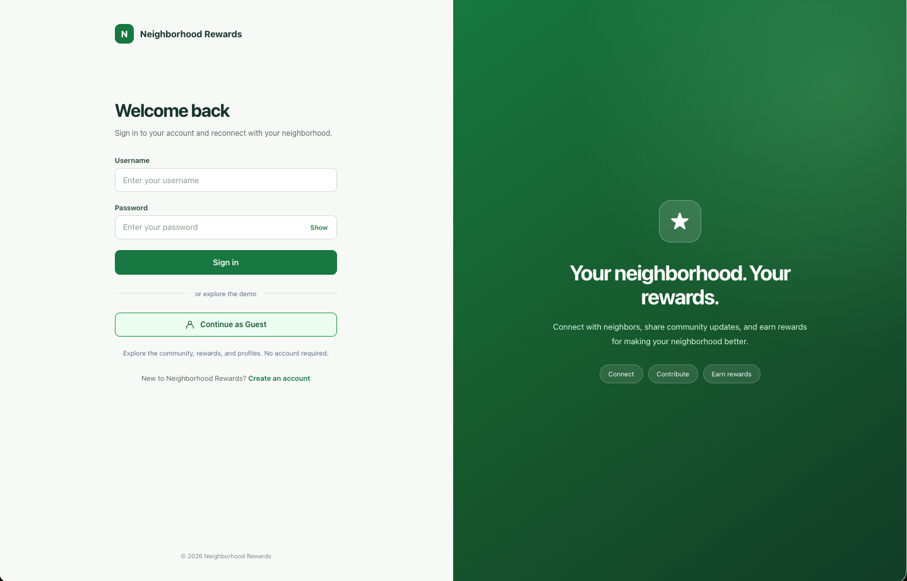
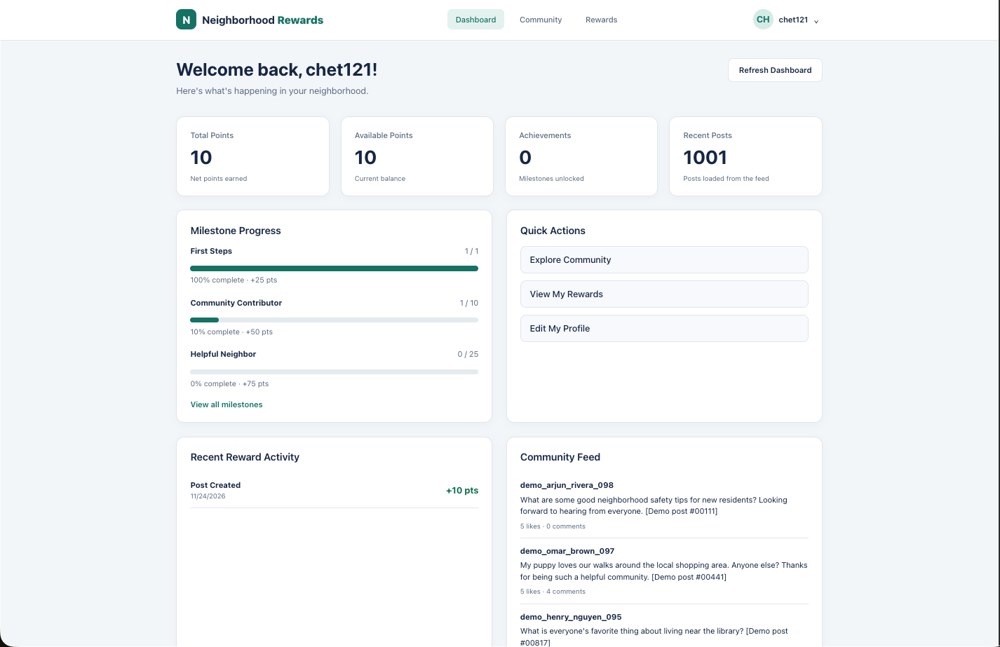
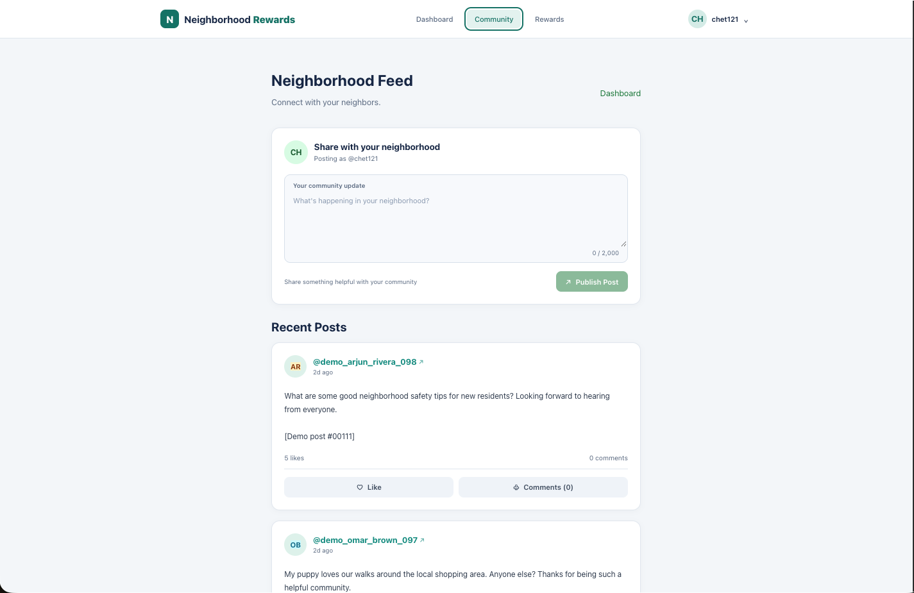
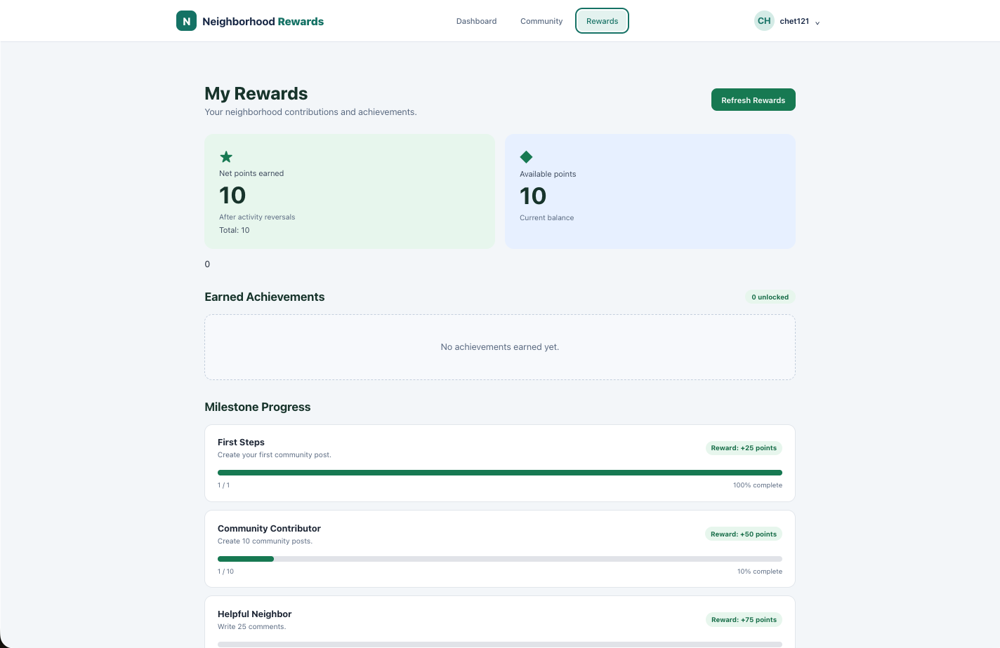
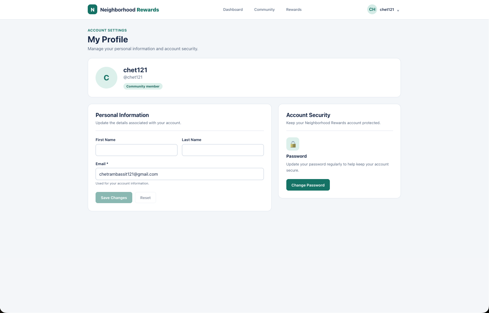
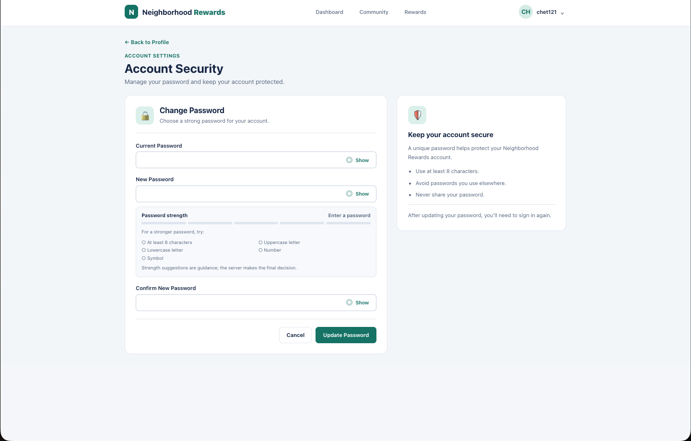
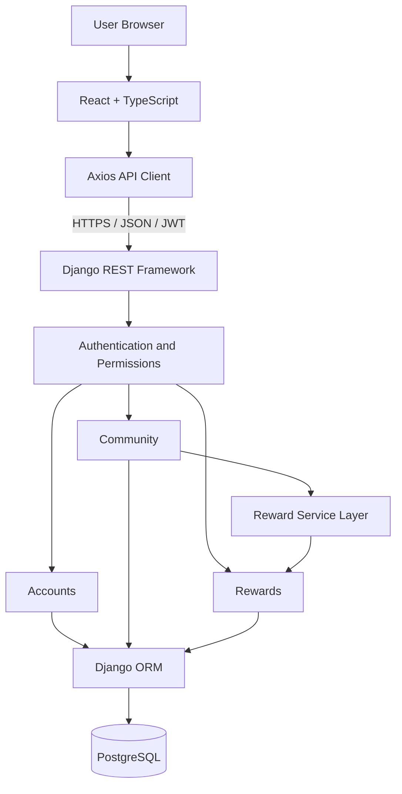
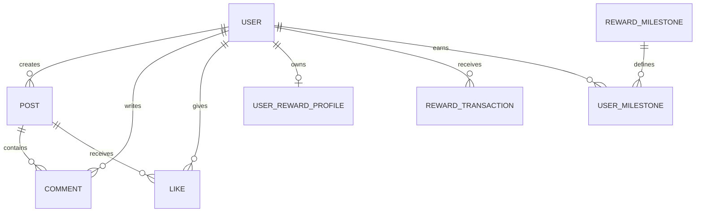
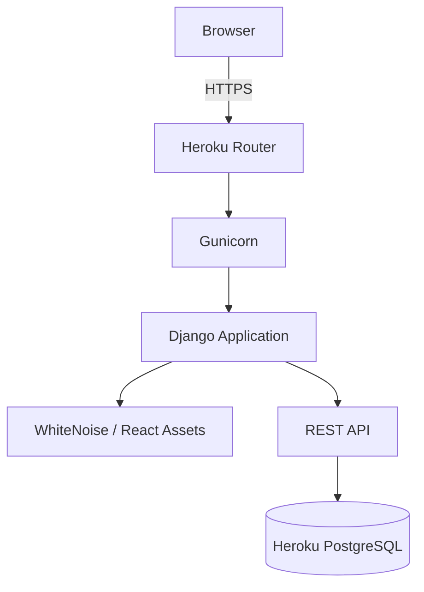

# Neighborhood Rewards

A full-stack community engagement platform that connects neighbors,
encourages meaningful interactions, and rewards active participation
through a milestone-based achievement system.

Built with Python, Django REST Framework, React, TypeScript,
and PostgreSQL. Deployed to Heroku.


## Live Demo

**Application:** [Neighborhood Rewards](https://neighborhood-rewards-demo-d3f65d8ee05d.herokuapp.com/login)

Visitors can explore the application without creating an account
by selecting **Continue as Guest** on the login page.

Guest accounts have read-only access, allowing visitors to explore
the community feed, rewards dashboard, and public user profiles
without modifying application data.


## Application Screenshots

### Login and Guest Access



### Dashboard



### Community Feed



### Rewards and Achievements



### Public User Profile



### Account Management




## Overview

Neighborhood Rewards demonstrates the end-to-end development of
a full-stack web application, from database design and REST API
development to frontend implementation, automated testing,
security configuration, and cloud deployment.

The platform combines social community features with a rewards
system designed to encourage positive engagement.

## Features

### Authentication and Account Management

- User registration and login
- JWT-based authentication
- Automatic access token refresh
- Guest authentication with read-only permissions
- User profile management
- Secure password changes
- Token invalidation following password changes
- Protected frontend routes

### Community Engagement

- Create and browse community posts
- Comment on other users' posts
- Like and unlike posts
- Delete owned posts and comments
- View engagement counts
- Navigate to public user profiles
- Responsive community feed
- Loading, error, and empty states

### Rewards and Achievements

- Milestone-based reward system
- Automated achievement detection
- Reward transaction history
- Reward balance tracking
- Progress toward achievements
- Activity reversal handling
- Duplicate reward prevention
- Public user rewards and achievements

### Demo Environment

- Fictional user generation
- Community post generation
- Contextual comments and likes
- Distributed community engagement
- Database validation and repair commands
- Read-only guest access

## Technology Stack

| Layer | Technologies |
|---|---|
| Frontend | React, TypeScript, Vite |
| Routing | React Router |
| HTTP Client | Axios |
| Styling | CSS, responsive design |
| Backend | Python, Django |
| REST API | Django REST Framework |
| Authentication | Simple JWT |
| Production Database | PostgreSQL |
| Local Database | SQLite |
| ORM | Django ORM |
| Backend Testing | Django TestCase, DRF testing utilities |
| Frontend Testing | Vitest, React Testing Library |
| Code Quality | Oxlint, TypeScript |
| Application Server | Gunicorn |
| Static File Serving | WhiteNoise |
| Deployment | Heroku |
| Version Control | Git, GitHub |

## System Architecture

The application uses a React single-page frontend communicating
with a Django REST API.

In production, both the frontend and backend are deployed through
a single Heroku application.



The backend is organized into domain-specific Django applications,
while the frontend separates pages, reusable components,
authentication state, API services, and TypeScript definitions.

## Project Structure

```text
nextdoor-rewards/
├── backend/
│   ├── accounts/
│   ├── community/
│   ├── rewards/
│   ├── core/
│   ├── config/
│   ├── manage.py
│   └── requirements.txt
│
├── frontend/
│   ├── public/
│   ├── src/
│   │   ├── components/
│   │   ├── context/
│   │   ├── pages/
│   │   ├── services/
│   │   ├── types/
│   │   ├── utils/
│   │   └── test/
│   ├── package.json
│   └── vite.config.ts
│
└── README.md
```

## Database Design

The application uses Django's ORM to manage relational data,
enforce constraints, and maintain relationships between users,
community activities, and rewards.

| Model | Responsibility |
|---|---|
| User | Authentication and account information |
| Post | User-generated community posts |
| Comment | Comments associated with posts |
| Like | User engagement with posts |
| UserRewardProfile | Total and available reward points |
| RewardTransaction | Reward awards and reversals |
| RewardMilestone | Achievement definitions and requirements |
| UserMilestone | Achievements earned by individual users |



Database-level unique constraints prevent duplicate likes,
duplicate milestone achievements, and duplicate reward transactions.

## REST API

### Authentication and Accounts

| Method | Endpoint | Description |
|---|---|---|
| POST | `/api/auth/register/` | Register a user |
| POST | `/api/auth/login/` | Obtain JWT tokens |
| POST | `/api/auth/guest-login/` | Authenticate as a guest |
| POST | `/api/auth/refresh/` | Refresh an access token |
| GET | `/api/auth/me/` | Retrieve the current user |
| GET | `/api/auth/profile/` | Retrieve account profile |
| PATCH | `/api/auth/profile/` | Update account profile |
| POST | `/api/auth/change-password/` | Change password |

### Community

| Method | Endpoint | Description |
|---|---|---|
| GET | `/api/community/posts/` | List community posts |
| POST | `/api/community/posts/` | Create a post |
| GET | `/api/community/posts/{id}/` | Retrieve a post |
| DELETE | `/api/community/posts/{id}/` | Delete an owned post |
| GET | `/api/community/posts/{id}/comments/` | List comments |
| POST | `/api/community/posts/{id}/comments/` | Create a comment |
| DELETE | `/api/community/posts/{id}/comments/{comment_id}/` | Delete an owned comment |
| POST | `/api/community/posts/{id}/like/` | Like a post |
| DELETE | `/api/community/posts/{id}/like/` | Unlike a post |

### Rewards

| Method | Endpoint | Description |
|---|---|---|
| GET | `/api/rewards/me/` | Retrieve reward summary |
| GET | `/api/rewards/transactions/` | Retrieve reward history |
| GET | `/api/rewards/milestones/` | List reward milestones |
| GET | `/api/rewards/achievements/` | List earned achievements |

### Public User Profiles

| Method | Endpoint | Description |
|---|---|---|
| GET | `/api/users/{user_id}/` | Retrieve public user profile |
| GET | `/api/users/{user_id}/rewards/` | Retrieve public user rewards |

### System

| Method | Endpoint | Description |
|---|---|---|
| GET | `/api/health/` | Application health check |

Authenticated API requests use the following HTTP header:

```http
Authorization: Bearer <access_token>
```

## Rewards System

The rewards system encourages community participation through
milestones rather than awarding points for every individual action.

Community activities are connected to a dedicated reward service
layer responsible for evaluating achievements and maintaining
reward transaction records.

Supported milestone categories include:

- Posts created
- Comments created
- Likes received
- Points accumulated

Important implementation details:

- Atomic database transactions protect related activity updates.
- Unique idempotency keys prevent duplicate reward transactions.
- Database constraints prevent duplicate achievements.
- Activity deletion and unliking trigger reversal handling.
- Previously earned milestones remain unlocked.

## Authentication and Security

The application implements JWT-based authentication using
Django REST Framework Simple JWT.

### Token Management

- Access tokens expire after 15 minutes.
- Refresh tokens expire after seven days.
- Axios interceptors attach access tokens to API requests.
- Expired access tokens are automatically refreshed.
- Concurrent authentication failures share one refresh request.
- Failed token refreshes clear the authentication state.
- Password changes invalidate existing authentication tokens.

### Authorization

- Backend permission classes enforce access restrictions.
- Users can only delete their own posts and comments.
- Duplicate likes are prevented.
- Users cannot like or comment on their own posts.
- Guest users cannot modify protected application data.
- Guest login requests are rate-limited.

### Production Security

- Environment-based secret management
- Production debug mode disabled through configuration
- HTTPS enforcement
- Secure session and CSRF cookies
- Allowed host validation
- PostgreSQL SSL configuration
- Django password validation

## Local Development

### Prerequisites

- Python 3.13 or compatible version
- Node.js compatible with the project's Vite version
- npm
- Git

PostgreSQL is optional for local development because the
application supports SQLite by default.

### 1. Clone the Repository

```bash
git clone https://github.com/chetrambassit121/nextdoor-rewards.git
cd nextdoor-rewards
```

### 2. Configure the Backend

```bash
cd backend

python3 -m venv .venv
source .venv/bin/activate

pip install -r requirements.txt
```

Create a `.env` file inside the `backend` directory:

```env
DJANGO_SECRET_KEY=replace-with-a-local-development-secret
DJANGO_DEBUG=True
DJANGO_ALLOWED_HOSTS=localhost,127.0.0.1
```

Never commit environment files or production credentials.

Apply database migrations:

```bash
python manage.py migrate
```

Initialize reward milestones and guest access:

```bash
python manage.py seed_milestones
python manage.py create_guest
```

Optionally create an administrator:

```bash
python manage.py createsuperuser
```

Start the backend:

```bash
python manage.py runserver
```

Backend URL:

```text
http://localhost:8000
```

### 3. Configure the Frontend

Open a separate terminal from the project root:

```bash
cd frontend
npm ci
```

Create a `.env.local` file:

```env
VITE_API_URL=http://localhost:8000/api
```

Start the frontend development server:

```bash
npm run dev
```

Frontend URL:

```text
http://localhost:5173
```

## Demo Data Generation

Neighborhood Rewards includes custom Django management commands
for generating a realistic fictional community.

From the backend directory:

```bash
python manage.py seed_demo --dry-run
```

The dry-run option executes the seed process and rolls back
database changes.

To populate a development or dedicated demo database:

```bash
python manage.py seed_demo
```

Default generation targets:

| Data | Target |
|---|---:|
| Fictional users | 100 |
| Community posts | 1,000 |
| Comments | 2,500 |
| Likes | 5,000 |
| Activity history | 90 days |

Custom generation targets are also supported:

```bash
python manage.py seed_demo \
  --users 100 \
  --posts 1000 \
  --comments 2500 \
  --likes 5000 \
  --days 90
```

Validate the generated data:

```bash
python manage.py validate_demo
```

Available management commands include:

- `seed_milestones`
- `seed_users`
- `seed_posts`
- `seed_interactions`
- `seed_demo`
- `validate_demo`
- `repair_demo_activity`
- `repair_demo_engagement`
- `create_guest`

Demo data is fictional and intended for demonstration purposes.

## Automated Testing

The project includes backend and frontend automated tests
covering application functionality and component behavior.

### Backend Tests

```bash
cd backend
source .venv/bin/activate

python manage.py check
python manage.py makemigrations --check --dry-run
python manage.py test
```

Backend tests cover areas including:

- Authentication and account management
- Guest access and permissions
- Community models and API endpoints
- Reward calculations and milestone achievements
- Reward reversal handling
- Public profiles and rewards

### Frontend Tests

```bash
cd frontend
npm run test:run
```

If worker initialization fails, run tests sequentially:

```bash
npx vitest run --pool=threads --maxWorkers=1 --no-file-parallelism
```

Frontend tests cover areas including:

- Login and registration
- Authentication context
- User profile management
- Password changes
- Dashboard components
- Community interactions
- Rewards dashboard

### Code Quality and Build Verification

```bash
npm run lint
npx tsc -b
npm run build
```

## Production Deployment

Neighborhood Rewards is deployed as a single Heroku application
using PostgreSQL as its production database.

The React frontend is compiled by Vite into:

```text
backend/frontend_dist/
```

Django serves the React single-page application, while WhiteNoise
serves compiled frontend assets and collected static files.

Gunicorn runs the Django application in production.



### Production Environment Variables

| Variable | Purpose |
|---|---|
| DJANGO_SECRET_KEY | Django application secret |
| DJANGO_DEBUG | Debug mode configuration |
| DJANGO_ALLOWED_HOSTS | Permitted hostnames |
| DJANGO_CSRF_TRUSTED_ORIGINS | Trusted HTTPS origins |
| DATABASE_URL | PostgreSQL connection URL |

### Production Verification

```bash
heroku run "cd backend && python manage.py check --deploy" \
  --app neighborhood-rewards-demo
```

```bash
heroku run "cd backend && python manage.py showmigrations" \
  --app neighborhood-rewards-demo
```

## Engineering Highlights

### Modular Backend Architecture

Domain-specific Django applications separate authentication,
community functionality, reward processing, and system utilities.

### Database Integrity

Atomic transactions, foreign key relationships, unique constraints,
and idempotency keys help maintain consistent application data.

### Query Optimization

Django ORM features such as `select_related`, `Count`, and `Exists`
reduce unnecessary queries when retrieving community posts and
engagement information.

### Centralized Authentication

React Context manages authentication state, while Axios interceptors
centralize token handling and automatic refresh behavior.

### Role-Based Access Restrictions

Guest access is enforced through backend permission classes,
rather than relying exclusively on disabled frontend controls.

### Automated Demo Data

Custom Django management commands generate, validate, and repair
fictional community data, supporting a populated demonstration
environment.

### End-to-End Delivery

The project encompasses database modeling, API development,
frontend implementation, automated testing, security configuration,
and cloud deployment.

## Future Enhancements

Potential future improvements include:

- Real-time notifications
- Community search and filtering
- Image attachments
- Dark mode
- Redis-backed caching
- Automated CI/CD pipelines
- Enhanced application monitoring
- Additional accessibility improvements

## Author

**Chetram Bassit**

Full-Stack Software Engineer

[LinkedIn](https://www.linkedin.com/in/chetram-bassit-4335a4202/)

## Disclaimer

Neighborhood Rewards is an independent software engineering
portfolio project. It is not affiliated with or endorsed by
Nextdoor or any other commercial neighborhood platform.

